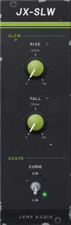
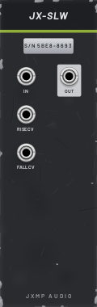
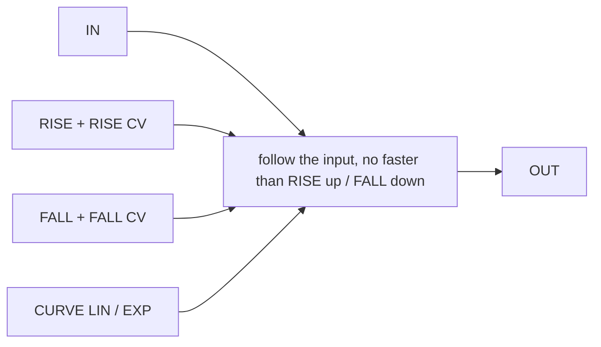

# JX-SLW — Slew

A slew limiter: limits how fast a signal may rise and fall. On a pitch CV it is glide (portamento).

8 HP · Envelope / modulation · Polyphonic · [all modules](README.md)

 

## What it does

JX-SLW smooths jumps. A note that jumps to the next one glides there instead; a gate that switches on and off becomes a
rounded envelope; a stepped random voltage becomes a smooth curve.

## How it works

- Rising and falling have their own time, 1 ms – 10 s (0 at the left = no limit).
- LIN moves at a constant speed; EXP moves fast first, then slower (like a capacitor).
- The two LEDs light while the output is rising or falling. Every channel is processed on its own.

## Quick start

1. Between [JX-QNT](jx-qnt.md) V/OCT out and [JX-OSC](jx-osc.md) V/OCT.
2. RISE and FALL to about 100 ms: notes glide into each other.

## Front panel

| Control | Range | What it does |
|---|---|---|
| RISE | 0, 1 ms – 10 s | Time to rise. |
| FALL | 0, 1 ms – 10 s | Time to fall. |
| CURVE (EXP / LIN) | LIN default | Shape of the movement. |

## Back panel (sockets)

`Tab` or `F2` turns the rack round.

| Socket | Signal | What it does |
|---|---|---|
| IN | Any, poly | Signal to slow down. |
| RISE CV, FALL CV | CV | 10 V = the full knob range. |
| OUT | Same as IN | The input limited to the RISE and FALL times. |

## Everything it can do

- Glide with different up and down times (glide up slow, down fast).
- A simple attack / release envelope from any gate.
- Smoothing of stepped CVs and clicks in modulation.

## Patch ideas

- **Glide:** between the quantizer and the oscillator, RISE = FALL ≈ 100 ms.
- **Envelope from a gate:** a gate into IN, RISE = attack, FALL = release, OUT → [JX-AMP](jx-amp.md) CV.
- **Smooth sequence:** [JX-SEQ](jx-seq.md) CV through JX-SLW into a filter cutoff.

## See also

[JX-ENV](jx-env.md) · [JX-RND](jx-rnd.md) · [JX-QNT](jx-qnt.md)
