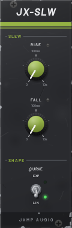
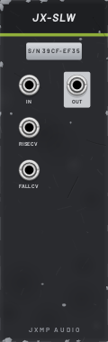

# JX-SLW — Slew

8 HP · JXMP Audio · [all modules](README.md)

Slew limiter: limits how fast a signal may rise and fall. On a pitch CV it is glide (portamento). Polyphonic.

 

## Front panel

| Control | What it does |
|---|---|
| RISE | Time to rise, 0 or 1 ms – 10 s. The LED lights while rising. |
| FALL | Time to fall, 0 or 1 ms – 10 s. The LED lights while falling. |
| CURVE  EXP / LIN | Linear (constant speed) or exponential (fast first, then slower, like a capacitor). |

## Sockets (back, `Tab` turns the rack)

| Socket | What it does |
|---|---|
| IN | Signal to slow down. Polyphonic. |
| RISE CV, FALL CV | 10 V = the full knob range. |
| OUT | The input, limited to the RISE and FALL times. |

## How to use it

- Glide: between JX-QNT and JX-OSC V/OCT, RISE = FALL around 100 ms.
- Simple envelope: a gate into IN gives an attack (RISE) and release (FALL) shape.
- Smooth a stepped JX-SEQ or JX-RND CV for slow movement.
