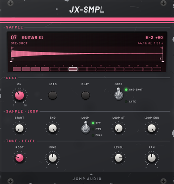
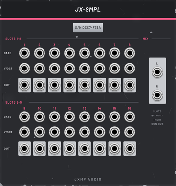

# JX-SMPL — Sampler

24 HP · JXMP Audio · [all modules](README.md)

16 sample slots in the spirit of the FastTracker 2 sample editor. Every slot holds one sound file from your computer (WAV, FLAC, MP3 or OGG): your own drums, a guitar note, a vocal, a pad. GATE n plays slot n, V/OCT n sets its note. Without a V/OCT cable a slot plays at its original pitch. The samples are saved inside the patch, so the patch works on another computer and in a DAW project.

 

## Front panel

| Control | What it does |
|---|---|
| Display | The selected slot: number, name, root note ("C-4") and fine tune, mode and loop, file rate and length. The waveform shows START / END (lines with S / E handles below; what they cut off is darkened) and the loop (flags at the top, shaded area; dimmed while the loop does not apply); drag a handle in the lower half or a flag in the upper half to move it. The mouse wheel over the wave zooms in around the pointer (down to single samples), dragging the wave moves along it, a double click shows the whole sample again; while zoomed, line 2 says ZOOM and a thin bar shows where you are. The row 1–16 shows every slot: filled = has a sample, bright = playing, white frame = selected; click one to select it. Drop a sound file on the module to load it into the selected slot. |
| CH | Selects the slot 1–16 that the display and the knobs below show. |
| ▲ ▼ ≡ ✓ | The menu: ≡ opens it over the whole display, ▲ ▼ move, ✓ (OK) opens a folder or runs the item. ≡ goes one folder back, and closes the menu at the top. The word MENU over the buttons lights up green while the menu is open. See *The menu* below. |
| PLAY | Plays the selected slot while held. |
| MODE | ONE-SHOT: a gate plays the sample to the end (drums). GATE: plays while the gate is high, then fades in 10 ms; a loop holds the tone. |
| START, END | The part of the sample that plays. |
| LOOP | OFF, FWD (from LOOP END back to LOOP ST), PING (back and forth). Only in GATE mode: turning LOOP ST / LOOP END otherwise shows "LOOP: GATE + FWD/PING". |
| LOOP ST, LOOP END | The loop. It is at least 16 samples long and always inside START…END (pushed against S or E it stops there and the display says so). |
| ROOT | The note the sample sounds at, FastTracker style (C-4 = 0 V on V/OCT). A guitar E recorded at E-2: set ROOT to E-2, and V/OCT plays it in tune. Menu › SAMPLE › DETECT ROOT finds it for you. |
| FINE | Fine tune, ±100 cents. |
| LEVEL | Level of the slot, 100 % = the sample as recorded. |
| PAN | Position of the slot in the MIX. For a stereo sample it works as a balance. |

The knobs below CH always belong to the selected slot: turn CH and they jump to that slot's values.

## Sockets (back, `Tab` turns the rack)

| Socket | What it does |
|---|---|
| GATE 1–16 | A rising edge plays the slot from START (a new hit fades the old sound out in 2 ms). |
| V/OCT 1–16 | The note (0 V = C-4). Without a cable the slot plays at its original pitch. |
| OUT 1–16 | The slot alone, mono, about ±5 V for a full-scale sample. Patching it takes the slot out of the MIX. |
| MIX L, R | All slots whose own OUT is not patched, panned. |
| REC IN L, IN R | What Menu › SAMPLE › RECORD records, ±5 V = full scale. Only one of them patched: a mono recording. |
| REC GATE | After RECORD: records while the gate is high (start and stop by a sequencer or clock). Without RECORD it does nothing. |

## Loading samples

- WAV (8, 16, 24 or 32 bit or float), FLAC, MP3 and OGG Vorbis; mono or stereo (more channels: the first two), any
  sample rate. An MP3 starts right on its first sound: the silence the encoder adds is taken off when the file says how
  much (LAME tag).
- Up to 60 s per slot; a longer file is shortened and the display says CUT TO 60 S.
- Menu › SAMPLE › BROWSE looks through your folders in the display, see *Browsing* below.
- Menu › SAMPLE › LOAD SAMPLE opens a file dialog for the selected slot, or drop a sound file on the module.
- Every load can be undone with Ctrl+Z (the slot's sample before comes back).
- Right click the module: Load… and Clear slot for the selected slot. Initialize empties all slots.

## The menu

Press ≡, choose with ▲ ▼, confirm with ✓. After an edit the display says what it did for a few seconds, and Ctrl+Z
undoes it (the sample, its points and the copy in the patch come back).

| Folder | Item | What it does |
|---|---|---|
| EDIT | CROP TO S-E | Throws away what START and END cut off: the sample gets shorter and takes less room in the patch. |
| | NORMALIZE | Raises the whole sample until its loudest peak is at full level; the display says by how much. |
| | REVERSE S-E | Turns the part between START and END backwards. |
| LOOP | CROSSFADE ▸ 5 / 10 / 20 / 50 MS | Smooths the loop seam: the end of the loop blends into what leads into LOOP ST, so the jump back does not click. Needs that much sound before LOOP ST. The dot marks the length used last. |
| | SNAP TO ZERO | Moves S, E and both loop points to the nearest place where the wave crosses zero going up: fewer clicks. |
| | SHOW SEAM | Shows the end of the loop (left) and its start (right) side by side, the way they join, and says SEAM IS SMOOTH or SEAM CLICKS. Wheel or double click leaves it. |
| VIEW | WAVE | Back to the wave from an envelope. |
| | ZOOM TO LOOP | Zooms in on the loop. |
| | WHOLE SAMPLE | Shows the whole sample (same as a double click). |
| ENV | VOLUME ▸, PAN ▸ | The envelopes of the slot, see *Envelopes* below. |
| | FADEOUT ▸ OFF … 5 S | After the gate ends the sound fades to silence in this time (GATE mode). Without a volume envelope it is the release time. |
| SAMPLE | RECORD | Records REC IN into the selected slot, see *Recording* below. |
| | BROWSE | Looks through a folder in the display and plays each file, see *Browsing* below. |
| | LOAD SAMPLE | Opens a file dialog for the selected slot. |
| | DETECT ROOT | Listens to START…END and sets ROOT to the note the sample sounds at and FINE to the rest, so V/OCT plays it in tune (a sample 30 cents sharp of A-5: ROOT A-5, FINE −30). Drums, noise and chords have no clear pitch: nothing changes and the display says NO CLEAR PITCH. Ctrl+Z undoes it. |
| | CLEAR SAMPLE | Empties the slot; asks first (✓ = yes, ≡ = no). |

A good loop in three steps: set LOOP ST and LOOP END roughly, SNAP TO ZERO, then CROSSFADE 20 MS and check SHOW SEAM.

## Browsing

Menu › SAMPLE › BROWSE fills the display with the folder used last (the first time your home folder): its folders
first, then its sound files (WAV, FLAC, MP3, OGG), each A–Z; the right column says the format.

- ▲ ▼ move through the list. A file you stop on plays once, whole, at its own pitch through the selected slot (its
  LEVEL and PAN, out of its OUT or MIX); below the list are its wave, length, format and MONO / ST.
- ✓ on a folder opens it, on `..` goes one folder up, on a file loads it into the selected slot and closes the
  browser. Ctrl+Z brings back what the slot held.
- ≡ closes the browser without loading anything.
- With the mouse: the wheel moves, a click selects (and plays) a row, a double click opens or loads it.
- The folder is remembered for every JX-SMPL, also after a restart. LOAD SAMPLE and dropping a file set it too.

## Recording

1. Patch what you want to record to REC IN L (and IN R for stereo) on the back.
2. Select the slot with CH and choose Menu › SAMPLE › RECORD. The display says ARMED and shows meters L / R: keep
   the peaks below 0 dB (±5 V); CLIP means louder than that (it is still recorded, as float).
3. ✓ starts, ✓ again stops. With REC GATE patched the gate does it instead: the recording runs while it is high.
   ≡ throws the recording away and leaves the slot as it was.

The recording replaces the slot's sample (named REC 03 for slot 3); Ctrl+Z brings the old one back. It is at most
60 s long, at PatchCore's sample rate, and is saved in the patch. The slot keeps its envelopes and fadeout. Nothing is
heard through the sampler while recording.

## Envelopes

Every slot has a volume and a pan envelope in the style of FastTracker 2 instruments: 2 to 12 points, time in seconds
from the gate (the same at any pitch). They are off until you switch them on.

- Menu › ENV › VOLUME (or PAN) › SHOW puts the envelope on the display instead of the wave, with the wave faintly
  behind it. Menu › VIEW › WAVE goes back.
- Click a point to select it (white), drag it to move it. Double click empty space to add a point, double click a
  point to remove it. The first point always stays at the start.
- ON / OFF switches the envelope. SUSTAIN AT POINT: in GATE mode the envelope waits on the selected point while the
  gate is high (dashed line SUS). LOOP START / END AT POINT: the part between two points repeats (tremolo, auto-pan).
  SUSTAIN OFF, LOOP OFF, RESET (a ready-made shape: a swell and decay for volume, a left-right loop for pan).
- After the gate ends the envelope runs on past the sustain. With a FADEOUT the loop keeps going until the fade is
  silent; without one the envelope leaves the loop and runs to its end. In ONE-SHOT mode there is no sustain.
- Pan: high = left, low = right, the middle = where the PAN knob is. The slot's own OUT is mono and has no pan.
- While the slot plays, a cursor runs over the envelope. Line 2 of the wave shows ENV V / P for the envelopes that are on.
- A new sound loaded into the slot keeps its envelopes and fadeout. Ctrl+Z undoes every change.

## How to use it

- Your own drum machine: JX-EUC GATE 1–4 → GATE 1–4 of a kick, snare, hat and clap; MIX → the console.
- A melody from one note: a guitar note in slot 7 in GATE mode with a loop, JX-SEQ CV → V/OCT 7, GATE → GATE 7. Smooth the loop with the menu (LOOP › SNAP TO ZERO, CROSSFADE).
- A pad that swells and pans: a long note in GATE mode with a loop, ENV › VOLUME on with a slow first point, ENV › PAN on (its RESET shape already moves left and right), FADEOUT 1 S.
- Resampling: patch MIX L / R to REC IN L / R and record what the slots play together into an empty slot.
- One drum through an effect: patch its OUT to JX-DLY; it leaves the MIX, the rest stays.
