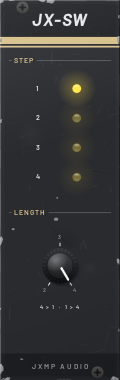
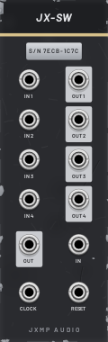
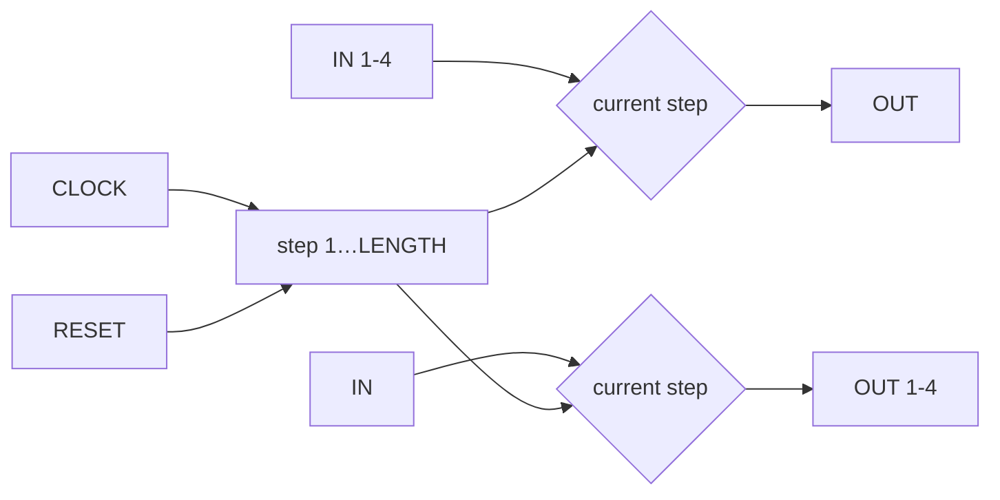

# JX-SW — Switch

A sequential switch in both directions at once: 4 → 1 (picks one of four inputs) and 1 → 4 (sends one input to one
of four outputs), moved by a clock.

8 HP · Mixing / routing · Polyphonic · [all modules](README.md)

 

## What it does

On every clock JX-SW moves to the next of 2–4 steps. On the 4 → 1 side it passes the input of the current step to
its OUT; on the 1 → 4 side it sends its IN to the output of the current step. That makes simple arpeggios, alternating
sounds or rotating routings.

## How it works

- Both directions share the step. The four LEDs show it.

## Quick start

1. Three pitch voltages ([JX-ATT](jx-att.md) offsets) into **IN 1–3**, LENGTH 3.
2. A clock into **CLOCK**, **OUT** → [JX-OSC](jx-osc.md) V/OCT: a three-note arpeggio.

## Front panel

| Control | Range | What it does |
|---|---|---|
| STEP 1–4 | LEDs | The current step. |
| LENGTH | 2 … 4 (4) | Steps before it comes back to step 1. |

## Back panel (sockets)

`Tab` or `F2` turns the rack round.

| Socket | Signal | What it does |
|---|---|---|
| IN 1–4 | Any, poly | 4 → 1: passed to OUT on their step. |
| OUT | Same as IN | 4 → 1: the input of the current step. |
| IN | Any, poly | 1 → 4: sent to the output of the current step. |
| OUT 1–4 | Same as IN | 1 → 4: get IN on their step. |
| CLOCK | Clock | Every rising edge moves one step. |
| RESET | Trigger | Back to step 1. |

## Patch ideas

- **Arpeggio:** see Quick start.
- **Alternating sounds:** one gate into IN, OUT 1–4 into four envelopes of different voices.
- **Changing effect:** a sound into IN, OUT 1–2 into a delay and a reverb, LENGTH 2: every other note goes to the
  other effect.

## See also

[JX-LGC](jx-lgc.md) · [JX-SEQ](jx-seq.md) · [JX-PLY](jx-ply.md)
