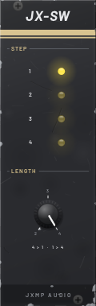
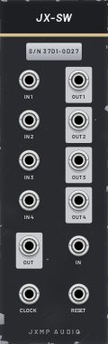

# JX-SW — Switch

8 HP · JXMP Audio · [all modules](README.md)

Sequential switch in both directions at once: 4 → 1 (picks one of four inputs) and 1 → 4 (sends one input to one of four outputs), moved by a clock.

 

## Front panel

| Control | What it does |
|---|---|
| STEP 1–4 | LEDs of the current step. |
| LENGTH | How many steps before it comes back to step 1, 2–4. |

## Sockets (back, `Tab` turns the rack)

| Socket | What it does |
|---|---|
| IN 1–4 | 4 → 1: passed to OUT on their step. |
| OUT | 4 → 1: the input of the current step. |
| IN | 1 → 4: sent to the output of the current step. |
| OUT 1–4 | 1 → 4: get IN on their step. |
| CLOCK | Every rising edge moves one step. |
| RESET | Back to step 1. |

## How to use it

- Arpeggio: three pitches into IN 1–3, LENGTH 3, a clock: OUT plays them in turn.
- Alternate sounds: one gate into IN, OUT 1–4 into four envelopes of different voices.
